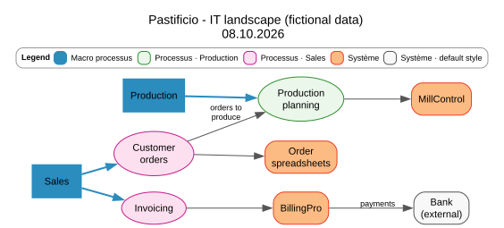
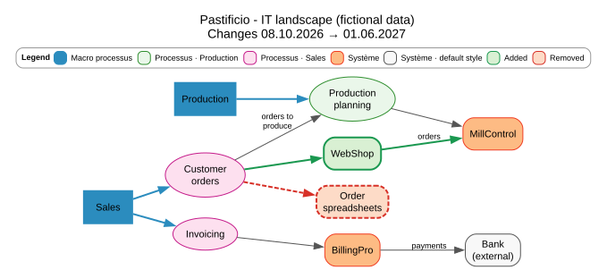

# Pasta

**Map a company's processes, IT systems and data flows from an Excel file, and see how they change over time.**



## Why

This is the public, anonymized prototype of a tool I am building for a real use case at work.

The map of an organization's information system (business processes, the applications that support them and the data flowing between them) is often kept in a spreadsheet. A spreadsheet is good for editing, but hard to read as a whole, and it says nothing about *time*. IT projects keep replacing systems, so people want to know:

- what the landscape looks like **on a given date**;
- what **changes** when a project goes live.

Pasta reads the spreadsheet, checks it, and draws both. All the data in this repository is **entirely fictional**: a small pasta factory whose order spreadsheets are replaced by an online shop.

## Features

- **One Excel workbook as input**: nodes (processes, systems), links (flows), projects and drawing parameters. Every row has a validity period.
- **Thorough validation**: the whole file is checked and **all** errors are reported at once, with the Excel row to fix. Examples: a link to an unknown node, a duplicate Id, an empty `Actif` cell, an end date before a start date.
- **Snapshot at any date**: only what exists on that day is drawn.
- **Comparison between two dates**: added elements in green, removed ones in red and dashed.

  
- **Two outputs from the same model**:
  - a static **SVG** drawn with [Graphviz](https://graphviz.org/);
  - an interactive **HTML** page made with [pyvis](https://pyvis.readthedocs.io/) and vis.js (zoom, drag, tooltips). The page is self-contained and works offline.
- **A legend built from the data**: it explains every color actually shown, so it also works with other files.
- **Style from the spreadsheet**: shapes and colors come from the Excel cells. Empty cells fall back to defaults in the `Parametres` sheet, then to built-in values.

## Requirements

- Python 3.11 or newer
- [Graphviz](https://graphviz.org/download/) installed, with the `dot` program on the `PATH` (needed for the SVG output)

## Installation

```bash
git clone https://github.com/RossAiland/pasta-portfolio.git
cd pasta-portfolio
python -m venv .venv
# Windows: .venv\Scripts\activate    macOS/Linux: source .venv/bin/activate
pip install -e ".[dev]"
```

## Usage

```bash
python -m pasta                      # uses config.toml
python -m pasta --config other.toml  # any other configuration file
```

`config.toml` says what to read and what to draw (relative paths start from the folder of the config file):

```toml
input_file = "data/sample_pastificio.xlsx"
output_dir = "output"

# Optional: date of the snapshot (default: DateReference in the Parametres sheet)
snapshot_date = 2026-10-08

# Optional: draw what changes between two dates
[compare]
before = 2026-10-08
after = 2027-06-01
```

With the sample configuration, the program writes four files to `output/`:

```
Written: output/snapshot_2026-10-08.svg
Written: output/snapshot_2026-10-08.html
Written: output/compare_2026-10-08_2027-06-01.svg
Written: output/compare_2026-10-08_2027-06-01.html
```

If the Excel file has errors, nothing is drawn and the program exits with code 1:

```
Error: The input file has 2 error(s):
  Noeuds, row 7: Actif must be True or False (found: empty)
  Liens, row 6: Cible 'MIILL' is not an Id in Noeuds
```

## Input file

Sheet and column names are in French, as in the original working file.

| Sheet | One row is… | Main columns |
|---|---|---|
| `Noeuds` | a node: macro process, process or system | `Id`, `Libelle` (label), `TypeElement`, `Domaine`, `Actif`, `DateDebut`, `DateFin`, `Projet`; optional style: `Shape`, `Style`, `Color`, `Fillcolor`, `Penwidth` |
| `Liens` | an arrow between two nodes | `Source`, `Cible` (target), `Libelle`, `TypeFlux` (flow type), `Direction`, `Données` (data, shown as tooltip), `Actif`, `DateDebut`, `DateFin`, `Projet`; optional style |
| `Projets` | a project that changes the landscape | `Id`, `Libelle`, `DateDebut`, `DateFin` |
| `Parametres` | a drawing setting | `Parametre`, `Valeur` (e.g. `Rankdir`, `NodeDefaultColor`, `DateReference`, `AddedColor`) |

A row exists on a day when `Actif` is true and `DateDebut ≤ day ≤ DateFin` (both bounds included). A link is drawn only if both its nodes exist.

The sample file is generated by a script, so it is reproducible:

```bash
python scripts/make_sample_data.py
```

## Project structure

```
pasta/
  config.py           read config.toml
  loader.py           Excel -> pandas tables (empty rows, dates, booleans)
  validation.py       collect every error with its Excel row
  timeline.py         what exists on a date; comparison between two dates
  model.py            Node / Edge / Graph with resolved styles and legend
  render_graphviz.py  Graph -> SVG
  render_html.py      Graph -> interactive HTML
  __main__.py         command line entry point
scripts/make_sample_data.py   builds the fictional sample Excel file
tests/                        pytest suite (unit and end-to-end tests)
```

The two renderers receive the same `Graph` object and know nothing about pandas or Excel. Adding the HTML output did not require any change to the timeline or the model.

## Development

```bash
pytest              # 88 tests; the Graphviz ones are skipped if Graphviz is not installed
ruff check .        # linter
ruff format .       # formatter
```

## About this project

I wrote this project while learning Python, coming from C++. The code comments are therefore deliberately detailed: they explain Python idioms (dataclasses, comprehensions, context managers, pandas masks…) and often compare them with C++. Several tests were checked with small "mutation" experiments, by breaking the code on purpose to make sure the tests notice.

## License

[MIT](LICENSE)
